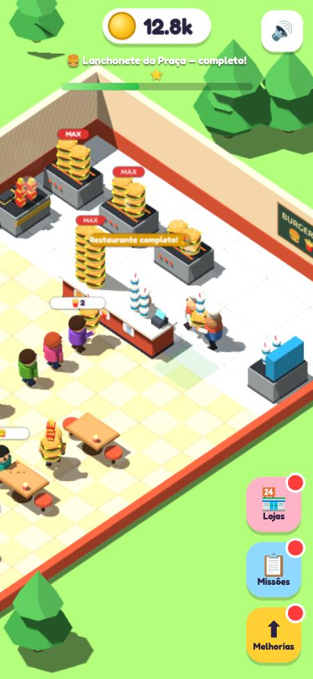
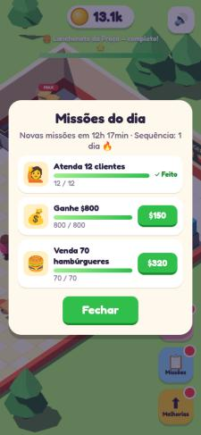
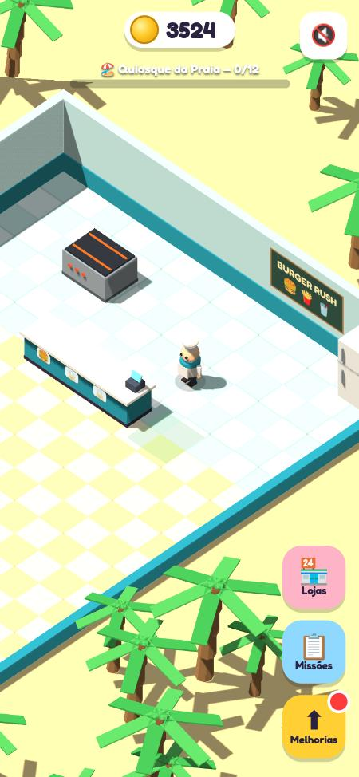
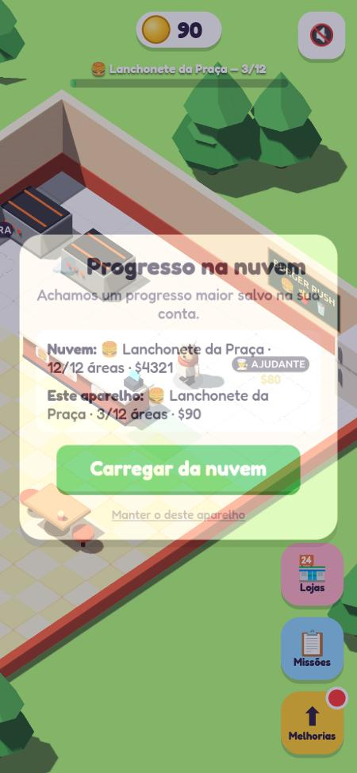

# Burger Rush

Jogo casual de lanchonete em 3D (Three.js), feito para jogar um pouco todo dia no celular ou no navegador.

## Como jogar

Arraste na tela (ou use WASD / setas) para mover o chef:

1. Pegue os lanches na chapa, na fritadeira e na máquina de refri.
2. Entregue no balcão; cada produto tem sua seção.
3. Recolha o dinheiro e pise nas áreas tracejadas para comprar mesas, máquinas e ajudantes.

## Conteúdo

- **Lanches:** hambúrguer, batata frita e refri, com pedidos combinados.
- **3 restaurantes:** Lanchonete da Praça, Quiosque da Praia e Praça de Alimentação. Cada um tem tema, preços e melhorias próprios. Os que você não está jogando rendem dinheiro passivo.
- **Missões diárias:** 3 por dia, renovadas à meia-noite.
- **Bônus de dias seguidos:** até 7 dias.
- **Ganhos offline:** até 60 minutos.
- **Progresso salvo** no aparelho, com versão de formato e migração automática (atualizações não quebram o save).
- **Save na nuvem** pelo Google Play Games (app Android): ao trocar de celular, o progresso volta sozinho.

## Estrutura

| Caminho | O que é |
|---|---|
| `www/index.html` | O jogo inteiro (HTML + JS) |
| `www/vendor/` | Three.js, fonte e Capacitor copiados do `node_modules` (`npm run vendor`), para o app abrir sem internet |
| `android/` | Projeto Android gerado pelo Capacitor |
| `android/app/src/main/java/.../PlayGamesSavesPlugin.java` | Plugin nativo do save na nuvem (Play Games Saved Games) |

## Rodar localmente

```bash
npm install
npm run serve
```

Abra http://localhost:8766. Use `?auto=1` para um robô jogar sozinho (modo de teste, não salva) e `?fresh=1` para começar sem save.

## Gerar o app Android

Precisa de JDK 17 e Android SDK 34 (`ANDROID_HOME`).

```bash
npm run apk      # APK de teste: android/app/build/outputs/apk/debug/app-debug.apk
npm run bundle   # .aab para a Google Play (exige a chave de assinatura, ver abaixo)
```

## Evoluir o save sem perder progresso

O save tem um campo `v`. Ao mudar o formato:

1. Suba `SAVE_VERSION` em `www/index.html`.
2. Acrescente um passo em `MIGRATIONS` que converte da versão anterior.
3. Nunca apague passos antigos.

Se a nuvem tiver um save de versão mais nova que o app, o jogo não sobrescreve e pede para atualizar.

## Publicar na Google Play (passo a passo)

1. Crie a conta de desenvolvedor em https://play.google.com/console (US$ 25, uma vez).
2. **Criar app**: nome "Burger Rush", tipo Jogo, gratuito.
3. **Chave de assinatura** (guarde fora do repositório):
   `keytool -genkey -v -keystore burger-rush.jks -alias burger -keyalg RSA -keysize 2048 -validity 10000`
   Crie `android/keystore.properties` (já ignorado pelo git) com `storeFile`, `storePassword`, `keyAlias` e `keyPassword`; o `build.gradle` usa automaticamente.
4. **Play Games Services** > Configurar: crie o projeto e ative **Jogos salvos** (Saved Games).
5. Copie o **ID do projeto** (só números) para `android/app/src/main/res/values/strings.xml` em `game_services_project_id`.
6. Em Play Games Services > Credenciais, adicione uma credencial Android com o pacote `io.github.eliseurizzonato.burgerrush` e o SHA-1 da chave de assinatura do app (Play Console > Integridade do app). Para testar o APK de debug, crie outra credencial com o SHA-1 da chave de debug.
7. Adicione seu e-mail em **Testadores** do Play Games Services, senão o login não funciona antes de publicar.
8. Gere o `.aab` (`npm run bundle`), envie para **Teste fechado**, preencha a política de privacidade, a classificação de conteúdo e a ficha da loja.
9. Contas pessoais novas precisam de 12 testadores por 14 dias no teste fechado antes da produção.

## Prints





